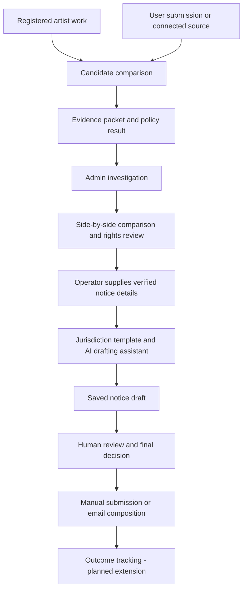
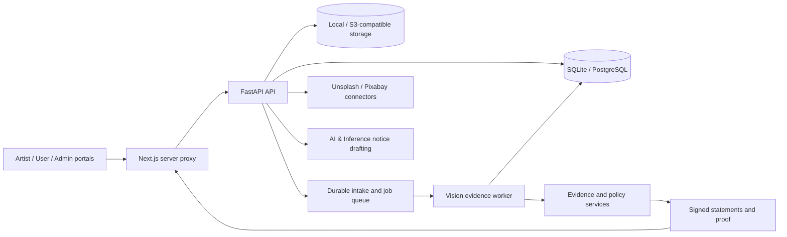

# CreatorProof — Complete Project Idea

> **See what matches. Prove what you checked. Turn evidence into action.**

This document packages the product idea, intended audience, workflows, technical architecture, current implementation, and future direction of CreatorProof. It describes the repository as it stands and separates existing capabilities from proposed extensions. API keys and other credentials are intentionally excluded.

## 1. The project in one paragraph

CreatorProof helps artists, creative teams, and platform operators protect and review visual work. Artists register reference images and creator profiles. Users submit candidate images to check for reuse of registered work, evidence of generative AI, and resemblance to a consenting creator's profile. The system produces separate evidence for each question, applies the organization's publication policy, and preserves an inspectable record. Admin operators review detected matches, compare the images side by side, and prepare country-aware copyright or illegal-content notices with an AI drafting assistant. A human decides what action to take and whether to submit a notice.

## 2. The problem

Creative work can be reposted, cropped, recolored, placed on merchandise, or changed with AI. Meanwhile, brands and agencies need to assess submitted assets before publishing them. Both situations create the same practical gap: finding a suspicious image is only the beginning of the job.

The reviewer still needs to know:

- Which registered artwork, if any, was reused?
- What visual evidence supports the comparison?
- Was the comparison complete, or did a model or source fail?
- Is there evidence of AI involvement?
- Does resemblance reflect copying, a shared subject, or an advisory style signal?
- Is the intended use covered by recorded rights or a license?
- What should happen next, and who makes that decision?
- Can the team preserve the result and explain it later?

CreatorProof connects those questions in one workflow, from registration through review and action.

## 3. The central product principle

**Copying, AI origin, creator resemblance, and permission are different questions.**

CreatorProof keeps their evidence separate. A strong similarity score does not establish copying on its own. An AI-origin signal does not establish copyright infringement. A visual match may be licensed. An incomplete search cannot establish that an image is original.

The product therefore follows this sequence:

```text
Register work → Inspect a candidate → Corroborate evidence
→ Apply policy → Human review → Prepare action → Preserve the record
```

This is the project's detection-to-action philosophy: each finding should have an understandable next step, supporting evidence, and an accountable operator.

## 4. Who it serves

| Audience | Primary need | CreatorProof's role |
| --- | --- | --- |
| Independent artists and designers | Keep a reference catalog and investigate suspected reuse | Registration, comparison evidence, and reviewable notice preparation |
| Agencies and brands | Review assets before campaigns or publication | Separate detection lanes, rights context, and publication decisions |
| Marketplaces and content platforms | Triage questionable submissions | Catalog comparisons, review cases, and documented operator actions |
| Rights and legal operators | Assess evidence and prepare a response | Side-by-side media, recorded source details, and notice drafts |

The initial focus is still images. Video, audio, and text protection are possible future extensions, rather than current product claims.

## 5. Three connected portals

### Artist portal — establish the reference catalog

The Artist portal is the starting point for protected work.

An artist or authorized operator registers an image with its title, catalog, claimant, claim state, and recorded rights information. The system validates the image, stores its reference representation, computes fingerprints, and creates versioned records used by later scans.

Creator profiles provide an additional, consent-backed resemblance context. An enrollment origin gate can also flag or reject images according to configuration. Registration records an assertion and supporting metadata; uploading a file alone does not prove ownership.

### User portal — submit and inspect an image

A user chooses a candidate image, the catalog to search, the intended use, and their country. CreatorProof runs its evidence pipeline and displays the result with progress information, evidence views, and the recorded policy outcome.

Completed scans with `MATCH_FOUND` are available in the Admin detections feed. The selected country is retained in the scan input binding so an operator can use it as notice-format context.

The user's selected country is not verification of the uploader's residence, the alleged copier's residence, or the law applicable to a particular dispute.

### Admin portal — assess and act

The Admin portal combines source monitoring, stored detections, review cases, and notice preparation.

The operator can:

1. Configure an image-source search against an artist catalog.
2. Review saved source history and new discoveries.
3. Inspect copied-work and AI-generated-version triage categories.
4. Select completed scan matches for further investigation.
5. Compare the submitted candidate and matched registered artwork side by side, when their media remains available.
6. Review the evidence and publication case.
7. Record an approval, rejection, license request, or escalation.
8. Enter claimant, protected-work, source-location, and recipient details.
9. Generate and inspect a jurisdiction-aware notice draft.
10. Open the draft in an email client or submit it through the recipient's official reporting channel.

Opening an email draft is recorded as an operator action. It does not confirm delivery or removal of the material.

## 6. The detection engine

CreatorProof uses three evidence lanes, followed by rights and policy evaluation.

### Copy lane — reuse of registered work

The copy lane searches the declared catalog and tests whether a candidate reuses a registered reference.

| Method | Purpose |
| --- | --- |
| SHA-256 | Identify byte-identical files |
| Perceptual hashing | Provide a cheap visual fingerprint and fallback signal |
| Meta SSCD embeddings | Retrieve visually related references, including regional candidates |
| SIFT / ORB local features | Find corresponding image features |
| USAC / MAGSAC geometry | Test whether correspondences support a coherent spatial transformation |
| Aligned structural comparison | Compare image structure inside a validated alignment |
| Deterministic evidence fusion | Require corroboration before a transformed-copy finding |

The design targets exact copies and transformations such as crops, resizing, recompression, mirrored reuse, overlays, and partial image reuse. Performance for each transformation needs project-specific evaluation; no universal accuracy is claimed.

Embedding similarity and perceptual hashes help locate candidates. They do not independently establish a transformed copy.

### Origin lane — evidence of generative-AI involvement

The origin lane combines distinct types of evidence:

- Signed content provenance inspected through C2PA tooling.
- Visible AI labels found with OCR.
- Sightengine's `genai` API when configured.
- Community Forensics and configured local or external detector adapters.
- Evidence-family, robustness, and abstention logic appropriate to the selected provider path.

With a healthy configured Sightengine request, local models are not used to shop for a different answer. Local fallbacks are available when the primary request fails.

The UI distinguishes AI signal strength from evidence quality. Missing provenance and quiet detector output do not prove human authorship.

### Creator-profile lane — advisory resemblance

The profile lane compares a candidate with registered creator profiles using optional CSD style embeddings and transparent visual diagnostics such as palette, tone, texture, edge direction, and tile consistency.

It also considers content similarity and catalog context so a shared subject does not automatically become a style attribution.

The output supports review. It does not identify an artist with certainty or establish infringement merely because two images resemble one another.

### Rights and publication policy

The evidence is evaluated against the intended use, recorded claims, rights path, and organization policy.

Publication outcomes include:

| Outcome | Meaning |
| --- | --- |
| `PASS_BY_POLICY` | The recorded evidence and rules permit the declared publication use |
| `REVIEW` | An operator needs to resolve uncertainty or rights questions |
| `BLOCK` | The configured rules require withholding the asset |

A policy outcome is distinct from a legal finding. A licensed visual match can remain `MATCH_FOUND` while passing the relevant publication policy.

## 7. Making the evidence visible

The Evidence Microscope lets a reviewer inspect the result instead of relying on a label alone. Depending on the available evidence, views include side-by-side images, copy support regions, correspondence points, aligned structure, AI-origin details, and creator-profile diagnostics.

The interface also reports source coverage and provider availability. If geometry does not validate, the system should not invent a copy region. If a provider is unavailable, that limitation remains visible.

Each scan produces an evidence packet containing its identifiers, catalog scope, coverage information, provider results, reason codes, match and policy outcomes, and proof metadata.

## 8. Discovering images beyond direct submissions

The current source connectors support **Unsplash and Pixabay**. They provide searchable images and metadata that can be submitted through the same catalog comparison pipeline.

The Admin monitor stores provider results, excludes repeated provider/external-image IDs from new discoveries, and preserves source history. New results can enter the scan pipeline.

These connectors are useful for integration testing and controlled source monitoring. They are not a reverse-image search of the entire internet. Search results from an image library do not, by themselves, imply misuse or unlicensed content.

The current monitor is controlled by the open Admin page and begins after a one-minute delay. Continuous monitoring should eventually be owned by a durable server scheduler. Current discovery deduplication uses provider identity; matching visually identical images across providers is a separate future improvement.

eBay and broader marketplace coverage are planned integrations, not implemented coverage described by this document.

## 9. From a match to a professional notice

The intended action workflow is:



### Country-aware preparation

The existing drafting service has template families for United States DMCA, European Union DSA notice-and-action, United Kingdom copyright notices, Canadian copyright notices, Australian removal requests, and a general international platform notice.

The selected country provides an initial format hint, while the Admin operator can choose the jurisdiction in the notice workspace. A production workflow needs verified mappings and platform-specific requirements. Other countries currently use the general template; this is not universal legal coverage.

### AI & Inference drafting

The backend integrates an OpenAI-compatible chat endpoint at AI & Inference, with `deepseek-ai/deepseek-v4-flash` as the configured default model.

The model receives a deterministic notice baseline, the jurisdiction checklist, and supplied factual context. Its instructions require it to preserve unknown information and avoid inventing owners, URLs, locations, registrations, or legal conclusions.

The draft is saved with its generation provider and model. If the API cannot produce a result, the deterministic template is saved as a fallback.

Drafting currently starts when an Admin operator supplies the required details and chooses **Generate notice**. A match does not independently trigger a complete AI-written notice or automatic delivery.

### Operator responsibility

Before submission, the operator needs verified claimant authority, the protected work's details, an exact public location for the disputed material, the appropriate recipient/channel, and a review of permissions and exceptions.

The country's name alone does not determine the correct procedure. Drafts are review aids; templates and model output still need validation for the actual platform and dispute.

## 10. Proof, integrity, and accountability

CreatorProof preserves evidence and reviewer activity so a later reviewer can inspect what was checked and what decision followed.

The architecture includes canonical packet hashing, signed evidence statements, append-only review events, and a local Merkle transparency log. Optional Ethereum Attestation Service integration can commit a packet hash to a public chain when configured and confirmed.

Only the hash commitment belongs in the public-chain proof path, not the artist's image or personal information. A local Merkle receipt is explicitly distinct from blockchain anchoring.

These mechanisms establish integrity and recorded provenance of the application's statements. They do not independently establish ownership, detector correctness, or legal infringement.

## 11. Technical architecture



| Component | Role |
| --- | --- |
| Next.js / React frontend | Landing experience, three portals, results, and evidence inspection |
| FastAPI backend | Authenticated registration, scan, review, connector, and drafting endpoints |
| Vision providers | Copy retrieval/verification, origin assessment, style diagnostics, and provenance |
| SQLite / PostgreSQL | Works, scans, input bindings, claims, cases, events, and notice drafts |
| Local / S3-compatible object storage | Reference images, candidates, source observations, and derived artifacts |
| Local / Redis job paths | Background scan execution and recovery |
| Outbox and stage ledger | Durable acceptance, retries, progress, and execution records |
| Security boundary | Tenant-scoped credentials, scopes, audit events, and optional PostgreSQL RLS |

External credentials stay on the server. Vision evidence, policy decisions, and notice text generation have separate responsibilities.

## 12. Current capability boundaries

| Area | Available in the repository | Remaining work or qualification |
| --- | --- | --- |
| Artist registration | Reference images, fingerprints, claims, rights metadata, and profile support | Enrollment assertions require corroboration and appropriate consent |
| User scanning | Three evidence lanes, intended use, country selection, and progress | Learned providers depend on installed artifacts and configuration |
| Admin detections | Persisted completed `MATCH_FOUND` scans and comparison workspace | Feed currently queries completed matches generally; stricter user/source segmentation can be added |
| Review actions | Publication approval/rejection, license request, and escalation | A separate enforcement disposition and appeal workflow can extend this |
| Connected discovery | Unsplash and Pixabay search, source observations, and saved history | Broader platforms and reverse-image discovery remain future work |
| Deduplication | Repeated provider/external IDs excluded from new discoveries | Cross-source visual deduplication remains future work |
| Notice drafting | AI-generated or fallback drafts with provider/model provenance | Operator supplies required facts; country coverage and templates need further validation |
| Notice delivery | Email composition and manual-submission action records | Automated delivery, acknowledgements, and removal tracking remain future work |
| Comparison media | Authenticated reference and candidate media endpoints | Candidate visibility depends on retention settings; zero-retention deployments can delete candidates after processing |
| Evidence integrity | Signed statements, packet hashes, and local proof | Public-chain proof requires configured infrastructure and confirmed transactions |
| Accuracy | Conservative evidence fusion and validation tooling | Broader real-world performance needs labeled benchmarks and calibration |

The implementation is a prototype with substantial infrastructure. Functionality in the repository is not a promise that every optional model, connector, or proof provider is active in every deployment.

## 13. Product experience and design

The visual direction uses black surfaces, blue accents, restrained glass effects, clear cards, and a coherent navigation system across Artist, User, and Admin. The landing page introduces the product with a blue animated hero and interactive background details.

The interface should lead with what the person can do next. Detailed forensic information remains available when they need to investigate or defend a decision.

Admin is the action workspace. Keeping those controls separate from submission makes the operator's role clear while preserving a connected workflow.

## 14. Example demonstration

1. Register an original artwork in the Artist portal under a known catalog.
2. Submit a matching image from the User portal, selecting that catalog, an intended use, and a country.
3. Show the copy result separately from the origin and creator-profile results.
4. Open the evidence views and inspect any validated correspondence or support region.
5. Open Admin and select the completed match from the detections feed.
6. Compare the submitted image with the registered reference.
7. Record a review decision appropriate to the evidence and permissions.
8. Supply verified notice details and generate the AI-assisted draft.
9. Review its text and generation provenance.
10. Demonstrate manual email composition or submission preparation without sending an actual notice during the demo.

Additional controlled demonstrations can use a permitted transformation, an unrelated image, or an AI-generated candidate. Demo examples should be clearly labeled and must not be presented as verified misuse by a real person.

## 15. Why the idea is distinctive

CreatorProof combines several useful capabilities in one review workflow:

- A registered catalog gives detection a specific reference scope.
- Independent lanes preserve the difference between copying, AI origin, and resemblance.
- Corroborated comparisons provide visual evidence an operator can inspect.
- Rights context separates a match from permission to publish.
- Admin actions connect findings to an accountable decision.
- AI-assisted notice preparation reduces drafting work while preserving human control.
- Evidence records and proof mechanisms make the process inspectable later.

The CopyFlag-inspired principle is the connection between detection, investigation, and action. CreatorProof adds its own emphasis on pre-publication review, separated evidence lanes, and verifiable records. It does not claim access to CopyFlag's private implementation.

## 16. Future development

### Make the existing action loop reliable

Preserve candidate media under an explicit review-retention policy, complete country mappings, distinguish user submissions from monitored scans, and add notice history retrieval. Require an explicit enforcement decision before delivery and retain the final operator-reviewed text.

### Expand discovery

Add approved platform connectors, reverse-image search providers, and durable server-side monitoring. Preserve exact source URLs, observation timestamps, and evidence snapshots. Add cross-source visual deduplication without deleting historical observations.

### Track outcomes

Record confirmed reuse, licensed use, false positives, submitted notices, acknowledgements, refusals, removals, appeals, and relisting. Treat these as verified workflow events rather than conclusions inferred from image similarity.

### Improve detection with measured evidence

Build labeled benchmarks for exact copies, transformed copies, AI modifications, style confounds, and hard negatives. Evaluate retrieval, false positives, localization, latency, and review burden. Promote models and thresholds based on those results.

### Prepare for sustained organizational use

Expand role controls, access policies, retention settings, integration monitoring, and recovery drills. Validate notice templates and platform processes with appropriate expertise. Offer APIs and webhooks for existing creative-review systems.

## 17. Possible business model

These are proposals rather than implemented billing features:

| Offering | Potential customers | Possible pricing basis |
| --- | --- | --- |
| Artist protection workspace | Independent creators and small studios | Registered works and monitoring scope |
| Team review workspace | Agencies and brands | Seats and scan volume |
| Platform API | Marketplaces and submission platforms | Usage and integration support |
| Organization deployment | Rights teams and larger institutions | Deployment, support, and operational requirements |

Product success should be measured through useful confirmed findings, false-positive burden, review time, evidence completeness, and documented outcomes—not raw notice volume.

## 18. Short pitch

**CreatorProof helps creative teams and artists move from suspicious images to informed action. Register original work, inspect candidates through independent copy, AI-origin, and creator-profile checks, and review the evidence in Admin. Operators can compare images, record decisions, and prepare country-aware notices with an AI drafting assistant, while preserving an inspectable record of what was checked.**

## 19. Repository references

- [Project README](README.md)
- [Model stack and inference](MODELS.md)
- [Developer setup](DEVELOPER_SETUP_GUIDE.md)
- [Admin operations](docs/ADMIN_OPERATIONS.md)
- [Source connector workflow](docs/MARKETPLACE_CONNECTORS.md)
- [Evidence Microscope](docs/EVIDENCE_MICROSCOPE.md)
- [CopyFlag philosophy and research notes](docs/COPYFLAG_PHILOSOPHY_INTEGRATION.md)
- [Blockchain implementation and deployment](docs/BLOCKCHAIN_IMPLEMENTATION_AND_DEPLOYMENT.md)

This brief describes the product and implementation. Operational guides and runtime checks remain the reference for what is configured in a specific deployment.
