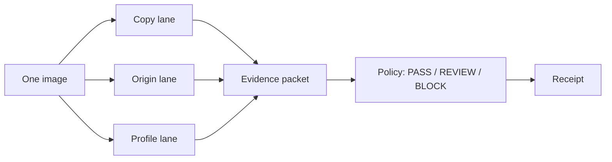

# CreatorProof

**“Is this safe to publish?” is the wrong question.**

It sounds like one decision. It is three: did we already license this picture,
did a generator help make it, and does it only *look like* someone we work with.
Every detector on the market mashes those into a percentage. A percentage cannot
tell a lawyer which question failed, or whether the system even looked.

CreatorProof is the pre-publication evidence layer for that moment. One image
in. Three independent answers out. The customer’s policy last. A receipt nobody
can quietly edit.

**[Open the live product →](https://creatorproof.uaenorth.cloudapp.azure.com/)**
· v0.10.0 · [How the models run](MODELS.md)

---

## The idea

A brand, agency, or marketplace is about to hit publish. Legal walks over.

| If the problem is… | A single “92% AI” score does… | CreatorProof does… |
| --- | --- | --- |
| A crop of a photo you already paid for | Nothing useful | Shows the **region** that matches a registered work |
| A generator with no Content Credentials | Pretends certainty | Separates **signed provenance**, **visible labels**, and **pixel models** |
| A new piece that merely resembles an artist | Calls it theft or ignores it | Treats resemblance as a **review**, not a copy finding |

The product is not “an AI detector.” It is **reviewable evidence** for creative
operations: what was checked, what succeeded, what is still unknown.



Lanes never vote into one confidence number. A copy match cannot hide origin
evidence. Policy cannot rewrite what the models saw.

---

## What a reviewer actually gets

Two portals, one scan.

- **Artist** — register works, attach a creator profile, gate origin at upload.
- **Checker** — drop an image, get three question cards, open the **Evidence Microscope** (side-by-side, copy regions, correspondence points, style map), then a sealed statement.

The UI leads with a bottom line a human can act on. Forensic detail is there
when they need to defend the call.

---

## Under the hood

Not three models. A **forensic stack** around them. Everything below is in this
repository.

### Copy — “does this reuse a work we have on file?”

Nomination is cheap. Saying MATCH is expensive on purpose.

| Layer | What it is |
| --- | --- |
| Exact identity | SHA-256 of the bytes |
| Perceptual hash | pHash, always on |
| Learned retrieval | Meta **SSCD DISC Mixup** (512-d). Whole image **plus five overlapping regions** so a pasted patch still ranks |
| Local features | SIFT, then ORB |
| Robust geometry | USAC / **MAGSAC** homography, inliers, coverage, symmetric transfer error, **mirror-aware** fit |
| Aligned structure | After a valid homography only: luminance/gradient correlation, GMS, SSIM on the support region |
| Fusion | Exact hash → exact copy. Otherwise MATCH needs geometry **and** structure. SSCD and pHash corroborate; they cannot MATCH alone |
| Microscope | Compact support envelopes and correspondence points — not a fake heatmap |

If geometry fails, the UI draws **no** invented copy region.

### Origin — “what evidence of a generator?”

Several different *kinds* of evidence, fused without score-shopping.

| Layer | What it is |
| --- | --- |
| Signed provenance | Official **c2patool** — trusted / untrusted / invalid / **absent = unknown**, not “human” |
| Visible labels | **Tesseract** OCR on the full frame and corners. A found “AI” label forces review; missing text is neutral |
| Pixel model | **Community Forensics** ViT-S/384, official eval crop (shorter side 440 → center 384) |
| Vendor model | **Sightengine `genai`**, one upload of the original. Locals run only if that call **fails**. A low vendor score is not shopped against a local one |
| Optional second family | **GRIP CLIP-based** detector (Apache-2.0), batched over views so weights are not reloaded per crop |
| Agreement | Multi-crop spatial consensus, evidence-**family** fusion, abstention. Two clones of one model cannot pose as independent votes |
| Readout | Separate **AI signal** and **evidence quality** indexes — not probabilities |

### Profile — “does this resemble a creator who asked us to watch?”

Resemblance is not copying and not identity.

| Layer | What it is |
| --- | --- |
| Learned style | **CSD ViT-L** descriptors + **CSLS** catalog readout |
| Mechanics | Palette, tone, stroke orientation, texture — transparent, always available |
| Tiles | Bidirectional tile consistency so one lucky patch cannot carry the image |
| Content confound | SSCD copy-similarity measured **beside** style, so “same subject” is not “same hand” |
| Enrollment | Versioned, **consent-backed** profile manifests. Tiny catalogs cannot mint high confidence |
| Correction | Family-wise multiplicity when many profiles are scored |

If CSD is off, diagnostics still run and the packet says `learned=false`.

### Decision, packet, proof

The models stop at evidence. Everything after is product.

| Layer | What it is |
| --- | --- |
| Policy | Deterministic PASS / REVIEW / BLOCK from the customer’s rules, not from a model head |
| Rights | Only **corroborated** claims can authorize a recorded use |
| Evidence packet | Hashable JSON: coverage, providers, fallbacks, reason codes, packet SHA-256 |
| Explainer | Optional OpenRouter text over **metrics only** — no image upload, cannot change the verdict |
| Local integrity | RFC 6962-style Merkle log, labelled **not blockchain** |
| Public chain | Optional **Ethereum Attestation Service** — 32-byte packet hash only, shown only when a tx actually confirms |
| Network | Multi-party co-attestation, EIP-712 counterparties, on-chain member registry when configured |
| Platform | Tenants, RLS, idempotent scans, durable jobs |

---

## Why this is the product

Anyone can call an “AI or not” API. The idea here is that **creative risk is
not one variable**, and that a reviewer should be able to *see* the overlapping
patch, the missing C2PA, the style card that did not leak into copy, and a
receipt for what was checked.

That is what you are looking at in the demo. The checkpoints are the published
ones used in copy-detection and AI-image research (SSCD, Community Forensics,
CSD), SHA-pinned so a clone runs the same inference. How they are wired,
overruled, and sealed is the system.

Pins, preprocess, and `make inference`: **[MODELS.md](MODELS.md)**.

---

## Run it

```bash
make inference          # fetch pinned SSCD + Community Forensics, probe them
cp .env.example .env
cd apps/api && uv sync --dev && uv run uvicorn app.main:app --reload --port 8000
cd apps/web && npm install && npm run dev
```

`http://localhost:3000` · Python 3.12+, [uv](https://docs.astral.sh/uv/), Node 20+.
Full setup: [DEVELOPER_SETUP_GUIDE.md](DEVELOPER_SETUP_GUIDE.md).

```text
apps/api/app/providers/    copy, origin, style, C2PA, OCR, proof
apps/api/app/services/     fusion, packets, policy, profiles
apps/api/model_lab/        cards and SHA-256 pins
apps/web/                  microscope and portals
```
