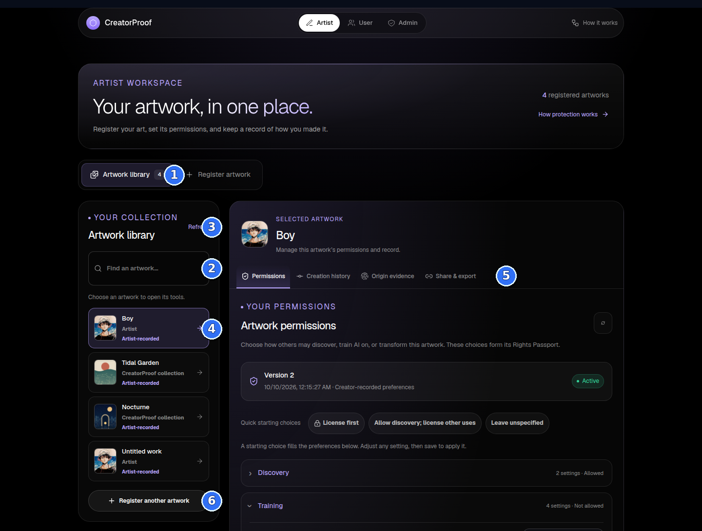
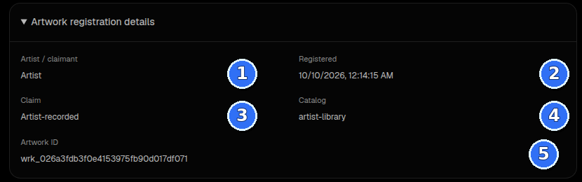
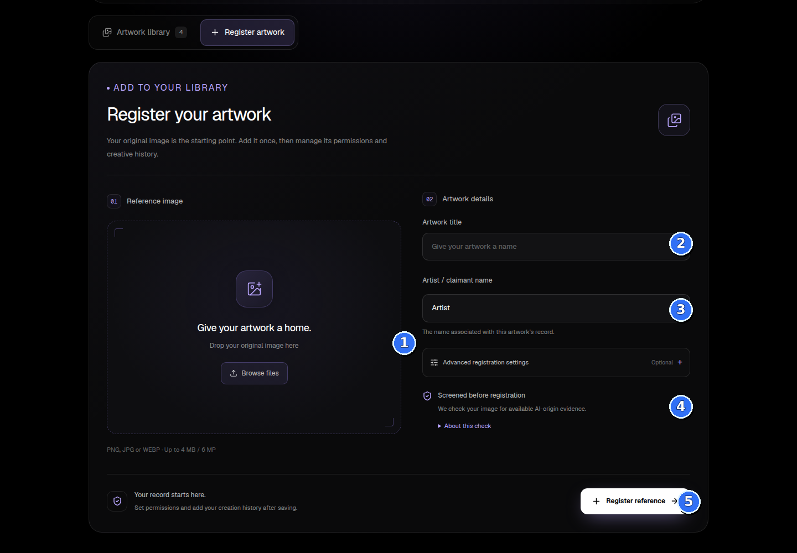
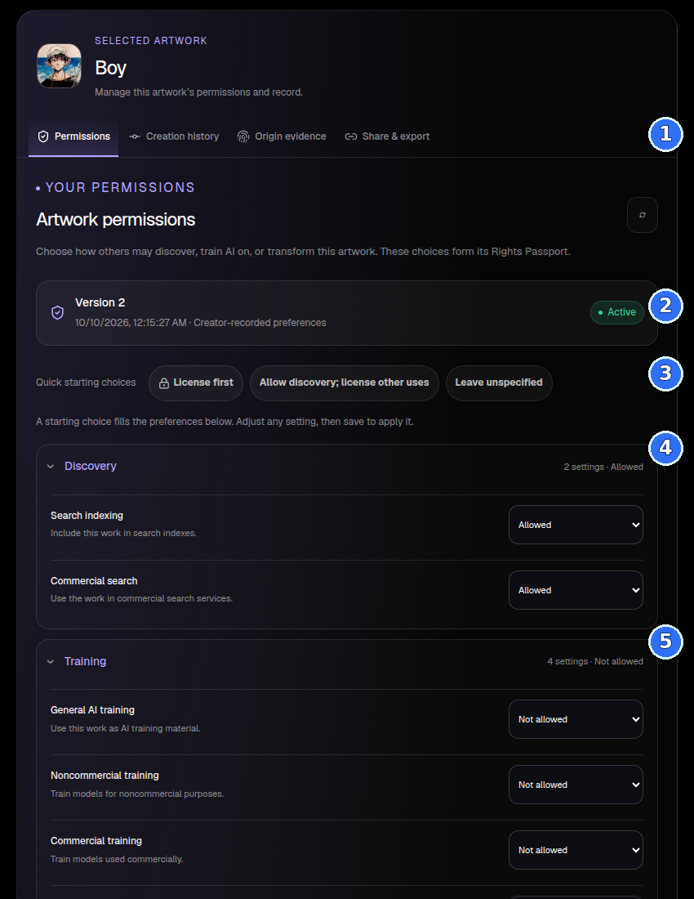
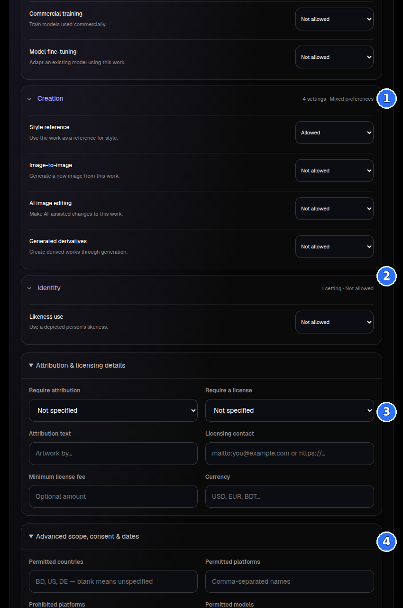
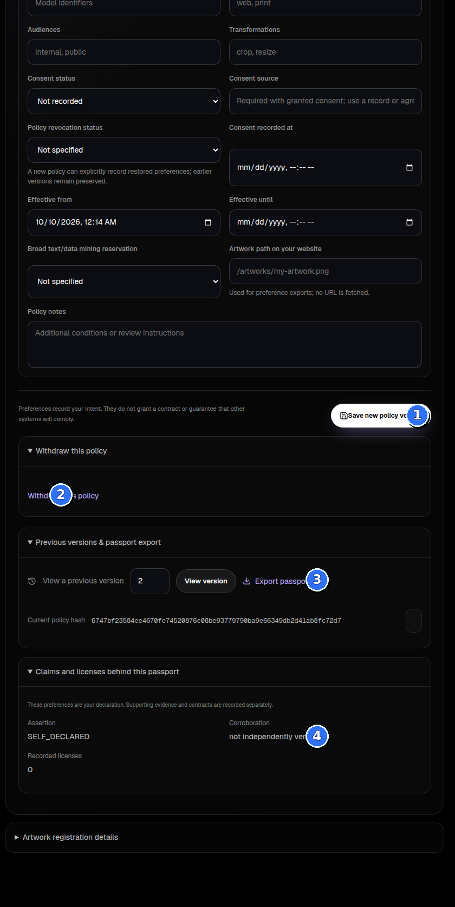
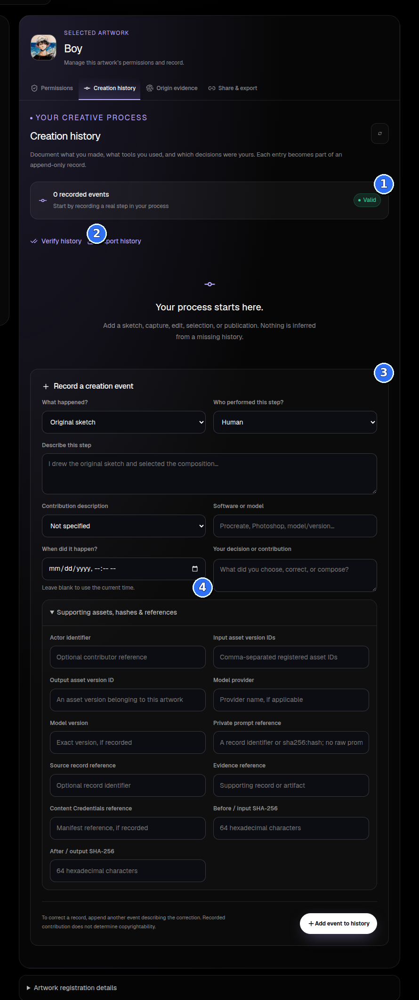
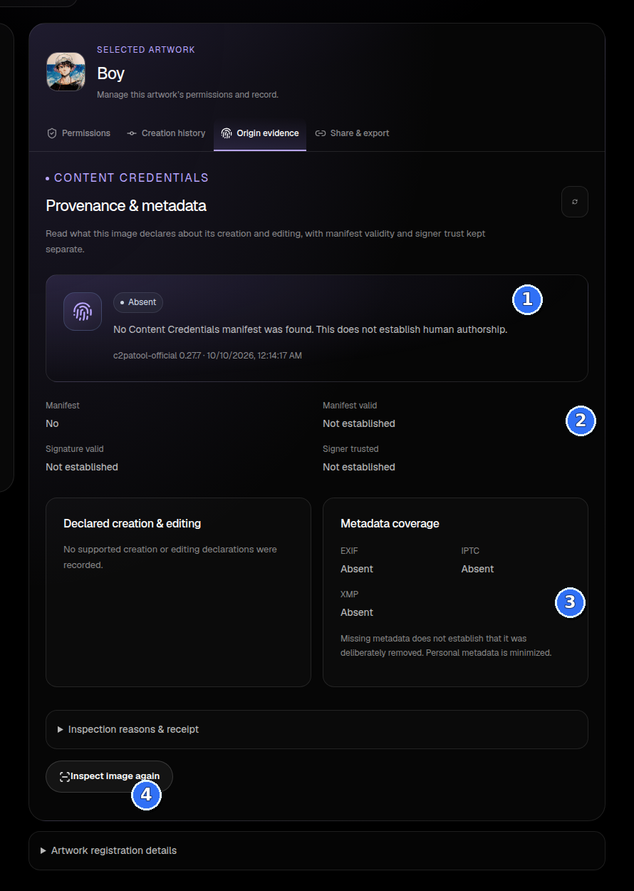
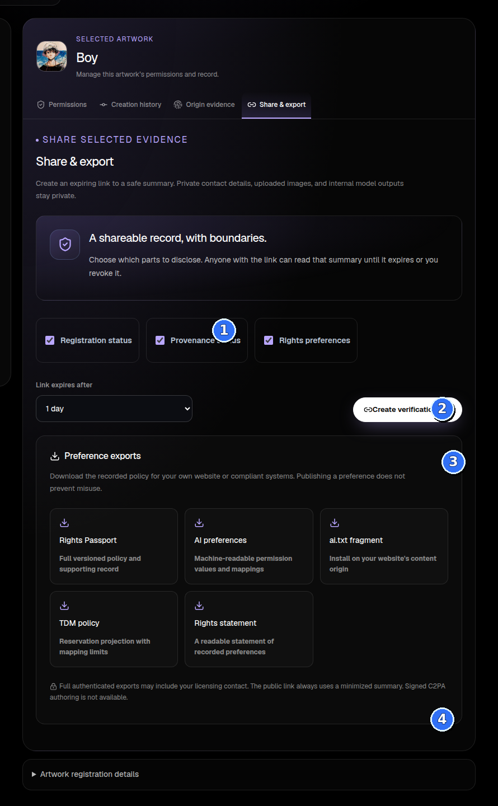

# CreatorProof Artwork Library: visual walkthrough

This guide explains the Artist portal’s **Artwork library** using screenshots of the running local website. The screenshots were captured on 10 October 2026. They show the library as it looked during the walkthrough, including a selected record named “Boy”; counts and saved values will change as the library changes.

## What the library is for

The Artwork library holds the artist’s **registered reference works**. A reference is the original image CreatorProof will compare against later candidate images. The library is not the place where submitted or discovered candidate images appear; those scans and flagged cases are in the User and Admin areas.

The page has two levels:

1. The left column helps you find and select a registered work.
2. The larger workspace on the right contains the selected work’s permissions, creation history, origin evidence, and sharing tools.

The global bar switches among the Artist, User and Admin portals. **How it works** opens the pipeline overview.

The blue numbered markers identify:

1. **Artwork library / Register artwork:** switch between your saved references and the upload form. The number on Artwork library is the current count of records returned to this page.
2. **Find an artwork:** filters the visible list by artwork title or artist/claimant name as you type.
3. **Refresh:** reloads the saved list from the server. Use it after registering a work or when the list may be stale.
4. **A work card:** select a work to load its own tools on the right. The card shows its title, claimant and claim status. The selected card has a highlighted border.
5. **Work tabs:** these tools apply to the selected work. Changing the selected card changes which work the tools edit or describe.
6. **Register another artwork:** opens the same registration form as the top Register artwork tab.

Below the right-hand workspace, open **Artwork registration details** to see the selected record’s fields:

1. **Artist / claimant** is the name attached to the record.
2. **Registered** is when this record was created.
3. **Claim** is the recorded status, such as Artist-recorded or Under review. “Artist-recorded” means the claim came from the artist; it does not mean a third party verified ownership.
4. **Catalog** is the named reference set used by scans. This screenshot’s selected artwork is in `artist-library`.
5. **Artwork ID** is the system’s identifier for this reference. Keep it when a support or evidence workflow asks which registered work you mean.

Save a policy or creation-history entry before selecting a different artwork. Each card has its own workspace; switching cards opens a different record.

## Register a reference image

1. Open **Register artwork**.
2. Drop an image onto the large box or choose **Browse files**. The form accepts PNG, JPG/JPEG and WEBP files up to 4 MB and 6 megapixels. You can replace or remove the selected file before submitting.
3. Enter a clear **Artwork title** and the correct **Artist / claimant name**. The claimant field may be prefilled from the current Artist portal; replace it if it is not the right person or organization.
4. Usually leave **Advanced registration settings** alone. The default catalog is `artist-library`, which is also the default catalog in the User scan form. Change it only when you deliberately use a different, matching catalog. The claim choices are **Artist-recorded**, **Supporting record declared**, **Under review** and **Withdrawn**. Choose the supporting-record option only when you actually have supporting records.
5. Read **Screened before registration**, then choose **Register reference**. CreatorProof checks for available AI-origin evidence before it saves the artwork. If the policy refuses the image, the form keeps your details and shows a reason so you can review the result or choose another image.

After a successful registration, return to the library and select the new card. The saved reference gets an Artwork ID and image fingerprints. Registering it records the artist’s claim; it does not itself establish copyright ownership. Passing the origin screening also does not prove that an image was made by a person.

## Keep the catalog names aligned

This is the most important setup detail when you want scans to find an artwork. A candidate scan searches **one named catalog at a time**. Its catalog must exactly match the catalog stored on the reference work.

- The normal registration default is `artist-library`.
- The User scan form also defaults to `artist-library`.
- Advanced registration settings can put a work in a different catalog.
- The library list can contain works from several catalogs, so its overall count is not necessarily the number of references searched by a scan.

In the screenshot, the library contains four works, but some cards belong to `creatorproof-collection` and others to `artist-library`. A scan using `artist-library` will not search the works stored only in `creatorproof-collection`. Check **Artwork registration details → Catalog** and use that same catalog name in the scan or monitor. If the scan reports an empty catalog, check this before interpreting a no-match result.

## Set permissions for one artwork

The **Permissions** tab is that work’s Rights Passport: a versioned record of what the artist says is allowed, disallowed, needs a license, or needs review. The screenshot shows the current saved settings for “Boy”; those values are not defaults for every work.

1. Check the policy **Version** and **Active** status. The small refresh button reloads the saved policy.
2. A **Quick starting choice** fills the settings below it; it does not save the policy. You can change any setting afterward.
   - **License first** sets each permission to “License required.”
   - **Allow discovery; license other uses** allows the two discovery settings and sets the other uses to “License required.”
   - **Leave unspecified** sets them to “Not specified.”
3. Expand a group and choose a value for each setting. The six choices mean:

| Choice | Plain meaning |
| --- | --- |
| **Allowed** | The recorded preference permits this use. |
| **Not allowed** | The recorded preference does not permit this use. |
| **License required** | Ask for permission under a separate license before this use. |
| **Ask for review** | Do not resolve this use automatically; have a person review it. |
| **Not specified** | No preference has been recorded. This is different from “Allowed.” |
| **Not applicable** | This permission does not apply to this work. |

The four groups cover these eleven settings:

- **Discovery:** Search indexing; Commercial search.
- **Training:** General AI training; Noncommercial training; Commercial training; Model fine-tuning.
- **Creation:** Style reference; Image-to-image; AI image editing; Generated derivatives.
- **Identity:** Likeness use for a depicted person.

The lower sections add terms that help explain a permission:

- **Attribution & licensing details:** whether credit or a license is required, the credit wording, licensing contact, minimum fee and currency.
- **Advanced scope, consent & dates:** permitted countries, platforms, models, channels, audiences and transformations; consent status/source; effective dates; a broad text/data-mining reservation; the artwork’s path on the artist’s website; and policy notes.

Leave a field unspecified when you do not have a clear value. A country list, license fee or model name narrows the record; it does not make an outside party follow it automatically.

- **Save new policy version** applies the choices and creates a new version. Earlier versions remain in the history. The selected artwork’s screenshot is at Version 2; new records may start with unknown permissions.
- **Withdraw this policy** records a withdrawn version after confirmation. It preserves prior history; existing contracts need separate review.
- **Previous versions & passport export** lets you view an earlier version read-only and export the passport.
- **Claims and licenses behind this passport** separates the artist’s declaration from any corroboration or recorded license. A self-declared claim is not independent verification.

Preferences describe the artist’s stated rules. They are not a signed contract, a legal ruling, or a technical block that forces unrelated websites to comply.

## Record how the artwork was made

Use **Creation history** to write a truthful, chronological account of real steps—for example, an original sketch, a manual edit, an AI-assisted step, a human selection, or publication.

1. **What happened?** selects the step type.
2. **Who performed this step?** records whether the actor was a human, AI, system or unknown.
3. **Describe this step** explains what happened in ordinary language. Add the contribution classification, software/model, date and the human’s decision where relevant.
4. **Supporting assets, hashes & references** is optional. Use it for real asset IDs, file hashes and source/evidence references. For a prompt, record a private reference or hash; do not paste the raw prompt into a field asking for a private prompt reference.
5. Choose **Add event to history**. Entries are append-only. To correct one, add another event describing the correction rather than trying to rewrite the earlier event.

**Verify history** checks whether the saved event hash chain is consistent. **Export history** downloads the record. A “Valid” integrity status means the stored record passed that check; it does not prove the events are true or determine authorship. An empty timeline is normal until you add events.

## Read origin evidence and metadata

The **Origin evidence** tab currently presents a Content Credentials/provenance and metadata inspection. It is not the same thing as the AI-origin detector or artwork-copy comparison.

- The top result summarizes whether a supported Content Credentials manifest was found and inspected.
- The fact rows separate manifest presence, manifest validity, signature validity and signer trust. One does not imply the others.
- **Declared creation & editing** shows actions and models declared in a supported manifest, when present.
- **Metadata coverage** reports whether EXIF, IPTC and XMP metadata were found. Missing metadata does not prove that someone removed it.
- Open **Inspection reasons & receipt** for reason codes and the inspected image hash.
- **Inspect image again** runs and saves another inspection; earlier inspection records are preserved. Refresh reloads the current saved result.

In the screenshot, the result is **Absent**: no Content Credentials manifest was found. That does not prove human authorship, prove AI use, or settle copying. Treat the panel as evidence about the image’s declared and available metadata only.

## Share a safe summary or download preference files

**Share & export** contains two different actions:

1. For a verification link, select the information to disclose: **Registration status**, **Provenance status** and/or **Rights preferences**. A person with the link can read that minimized summary until it expires or you revoke it.
2. Choose an expiry—1 hour, 1 day, 7 days or 30 days—then choose **Create verification link**. Copy the generated link and send it only to people who should see the selected summary. The link list is saved in this browser; active links can be revoked from there. The link grants access to anyone who has it, so treat it like a secret.
3. The **Preference exports** are downloads: Rights Passport JSON, AI preferences JSON, an `ai.txt` fragment, TDM policy JSON, and a readable rights statement. They do not install themselves on the artist’s website. The artist or site operator must publish the relevant file at the correct website location.

The public verification link omits private contact details, uploaded images and internal model outputs. A full authenticated export may include the licensing contact, so inspect it before sharing. An export or preference link does not prevent misuse, and signed C2PA authoring is not available in this screen.

## A practical first-use sequence

1. Register the original image with a clear title and correct claimant.
2. Confirm its catalog in **Artwork registration details**. Keep the default `artist-library` if you want it in the default User scan.
3. Open **Permissions**. Choose a starting preset only if it matches the artist’s real intent; review every group and add accurate credit/contact/scope details. Save the policy version.
4. Add known real creation steps in **Creation history**. Verify and export if you need a portable record.
5. Check **Origin evidence** for signed creation declarations and metadata. Read an absent or unavailable result as “not found/checked,” not as proof of human origin.
6. Use **Share & export** to share only the selected facts or download preferences. Do not imply that downloading a preference file publishes it.
7. In the User portal, submit a candidate and scan the same catalog. A flagged scan then becomes available for human review in Admin.

## What each area does not do

- The Artwork library does not show candidate detections or prove that an outside use is unauthorized.
- A registered image, artist-recorded claim, integrity hash or similarity score does not by itself prove legal ownership or infringement.
- A permission preference records the artist’s intent; it does not create a license contract or enforce itself across the web.
- A “no match” result means no supported reuse was found in the catalog and sources actually checked. It does not mean the image is unused everywhere.
- A provenance result describes available embedded declarations and metadata. It cannot determine every tool used to create an image.

The annotated screenshots are stored beside this guide in [`docs/guides/artwork-library/images`](artwork-library/images/). The related UI is implemented in the [Artist portal](../../apps/web/app/artist/page.tsx), [per-artwork workspace](../../apps/web/app/components/ArtistWorkspace.tsx), and its [permissions](../../apps/web/app/components/RightsPassport.tsx), [creation history](../../apps/web/app/components/ContributionLedger.tsx), [origin evidence](../../apps/web/app/components/ProvenancePanel.tsx), and [sharing](../../apps/web/app/components/ShareVerification.tsx) panels.
